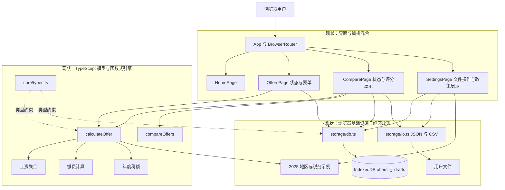
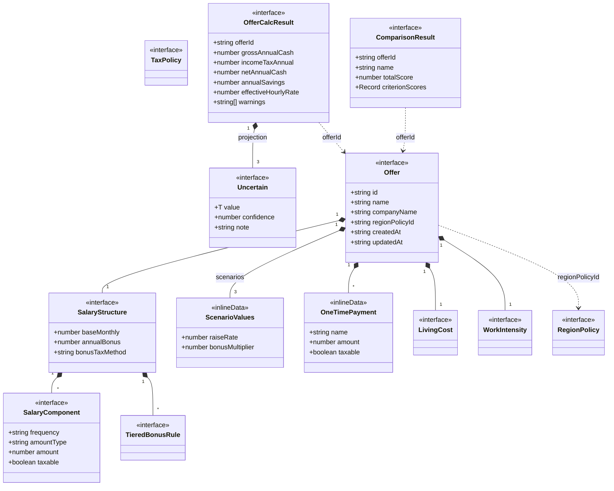
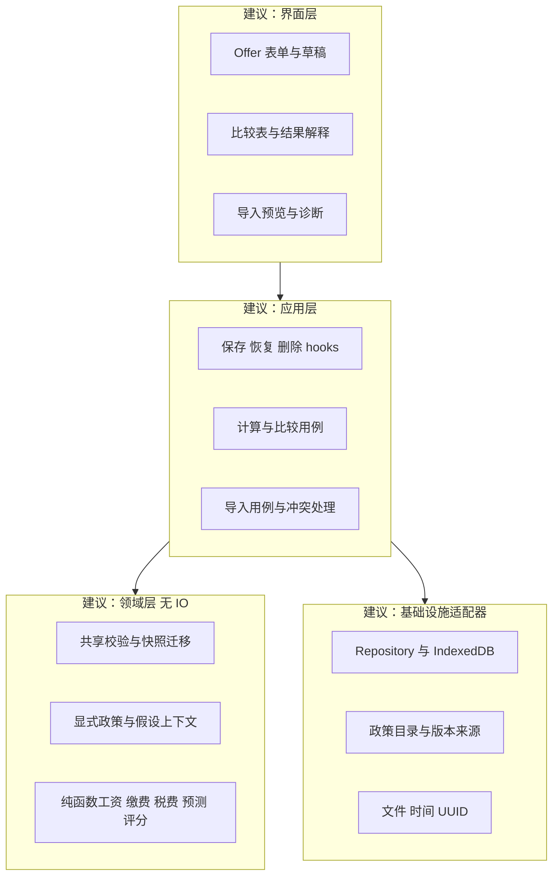
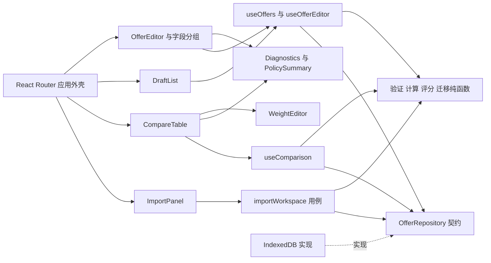
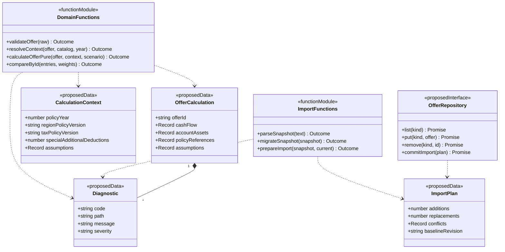
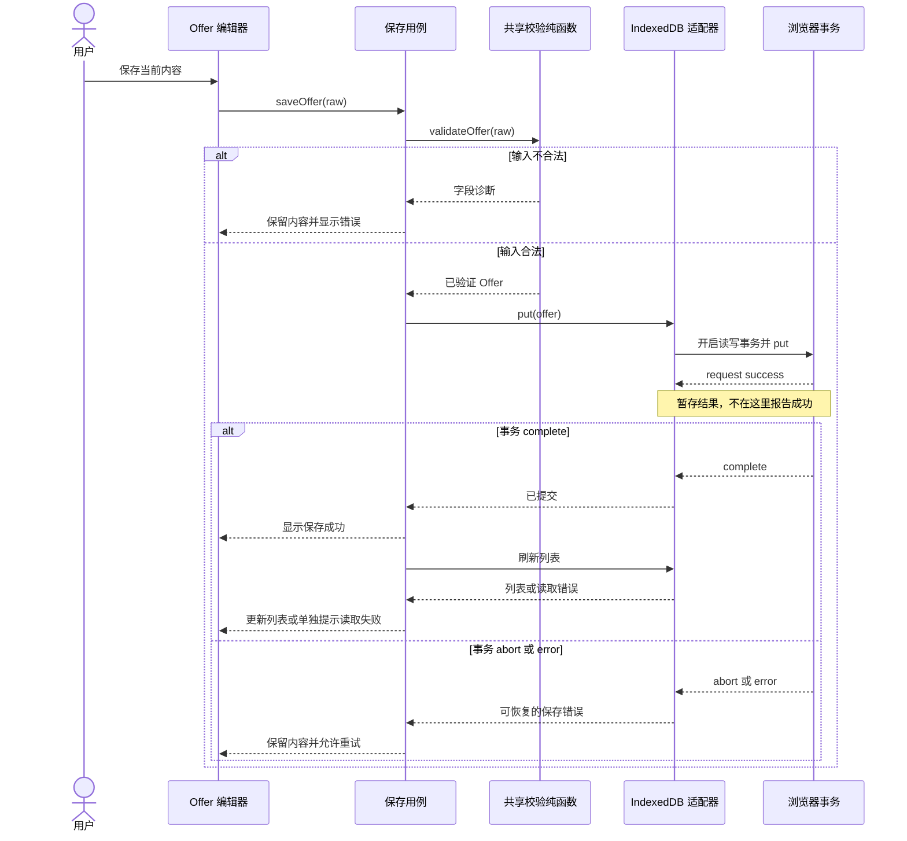
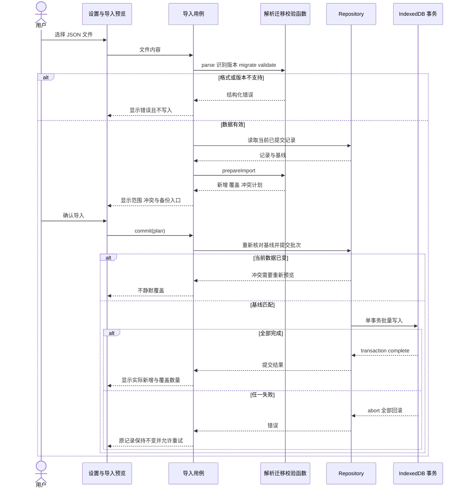
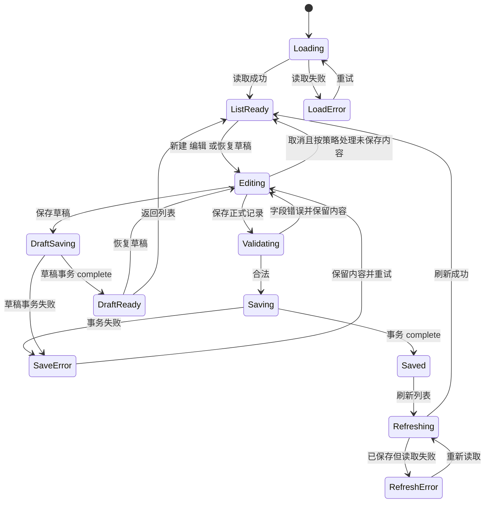

# Offerithm 架构设计

> 本文为初始分析/方案快照；最新落地状态与验证边界见 [阶段0进展](04-phase0-progress.md)。

本文按“现状”和“建议目标”分别描述。现状来自四份 [调查证据](evidence/)，建议用于后续决策，不代表应用已经重构。本轮仅新增分析文档；没有引入后端、状态库、数据库服务或新运行依赖。

## 1. 当前架构与职责

当前为 React 18 + React Router 6 + TypeScript + Vite 的静态单页应用。React 页面直接组织状态、计算和 IO；`core` 有明确的函数式计算模块，`storage` 封装 IndexedDB 与文件序列化，`policies` 存放静态示例。没有服务端 API。构建输出 `dist`，有 GitHub Pages workflow；实际发布可用性需独立验证。

### 图 A：现状分层架构

现状关键接口：`calculateOffer(Offer, CalcOptions?) → OfferCalcResult`（`src/core/engine/index.ts:19`）；`aggregateSalary`/`monthlyInsuranceBase`（`src/core/engine/salary.ts:4,39`）；`calculateInsurance`（`src/core/engine/insurance.ts:20`）；`calculateAnnualTax`（`src/core/engine/tax.ts:43`）；`compareOffers(offers, results, weights)`（`src/core/engine/compare.ts:17`）。后者依赖两个数组同序，页面又混用排名顺序，是应去除的脆弱契约。

当前领域并非类层次。以下 UML 是现有 TypeScript 接口/内联数据关系，并不建议将其改写为运行时 class。`ScenarioValues` 和 `OneTimePayment` 是为画图命名的内联结构，源码中不是独立接口。

### 图 B：现有数据模型 UML

来源为 `src/core/types.ts:8,17,40,62,92,105,118,133,159,201`。图只列关键字段，未画出所有明细；可选字段如 `note` 的可选性以源码为准。政策类型存在不等于提供用户编辑器；`Uncertain.confidence` 存在不等于经过统计校准。

## 2. 建议目标：纯函数核心与浏览器外壳

继续使用 React、本地 IndexedDB 和静态部署，增加薄应用层和共享运行时边界。先保留现有函数和模型作为兼容入口，按阶段提取；不为架构图创建无用类，也不把简单本地状态迁入全局状态库。

### 图 C：建议目标分层架构

图 C 仅显示层级依赖，具体组件关系见图 D；图中适配器是浏览器实现，其仓储接口归应用契约，不能反向让核心依赖具体存储。依赖方向为 UI → 应用用例 → 核心契约/适配器，核心不导入 React、IndexedDB、文件 API 或系统时间。现有 `calculateOffer` 默认读静态政策的便利入口可暂保留，目标计算入口显式接收上下文，保证同样数据和政策得到同样结果。输入、导入、草稿恢复和数据迁移使用相同校验规则。

### 图 D：建议组件依赖图

组件图表示建议职责，不要求一开始全部拆文件；只在状态/复用边界稳定时提取。仍优先原生表单和局部 hook，避免增加不必要的通用组件框架。

## 3. 建议接口与数据契约

下列名字全部是拟新增或演进契约，不能当成当前可调用 API。接口使用函数/对象组合实现，不要求类和依赖注入容器。

| 拟议契约 | 输入与结果 | 关键保证 |
| --- | --- | --- |
| `validateOffer(raw)` | `unknown → Outcome<Offer>` | 嵌套字段、有限数、范围、比例、日期、ID、阶梯顺序等；返回字段路径与诊断码，不直接修改输入 |
| `parseSnapshot(text)` | `string → Outcome<SupportedSnapshot>` | 应用标识、格式版本、体积上限、重复 ID；不做 IO、不写数据库 |
| `migrateSnapshot(snapshot)` | 可识别旧版本 → 当前验证后快照 | 版本逐步迁移；拒绝未知未来版本；不以默认值掩盖未知字段语义 |
| `resolveContext(offer, catalog, year, assumptions)` | `Outcome<CalculationContext>` | 显式地区/税务版本、来源、扣除、舍入、缺政策处理；是否阻断关键缺失由业务确认 |
| `calculateOfferPure(offer, context, scenario)` | `Outcome<OfferCalculation>` | 完整现金与税基分离；账户资产与可支配现金分开；结果携带假设、诊断和政策引用 |
| `compareById(entries, weights)` | `{offer, result}[] → Outcome<ComparisonResult[]>` | ID 一致且唯一；去除并行数组依赖；零权重/并列有明确规则；渲染再按 ID 查找 |
| `OfferRepository` | `list(kind) / put(kind, offer) / remove(kind,id) / commitImport(plan)` | Promise 仅在事务 complete 后成功；失败包含可恢复信息；批量导入原子提交 |
| `prepareImport(snapshot, current)` | `Outcome<ImportPlan>` | 新增/覆盖/冲突/忽略计数可解释；不写数据；提交时重新核对变更 |

`Outcome<T>` 建议为成功值及 warnings，或失败的结构化 errors；`Diagnostic` 至少含 code、path、message、severity。运行时验证库选型尚未决定，可以先用小型纯函数，不预设需要新增依赖。

### 图 E：拟新增接口 UML

`baselineRevision` 是乐观并发控制的建议概念，具体可由内容摘要或记录修订号实现，尚未选择；不能误称现有存储已有 revision。金额先明确精度和舍入边界，是否改为整数分或 decimal 需结合税表、费率、迁移成本决定，不在规划中无证据强制换数值库。

## 4. 关键交互与状态

### 图 F：建议保存 Offer 时序

现状差异：`withStore` 在 request success 时就 resolve（`src/storage/db.ts:30`），页面把写入和 refresh 放在同一异常处理范围（`src/pages/OffersPage.tsx:56`）。图 F 是目标行为，未声称本次已实现。正式保存后是否清理同 ID 草稿必须定案；若要求一起成功，需同一事务同时覆盖 offers/drafts。

### 图 G：建议 JSON 导入时序

现状为按输入数组逐条 upsert（`src/pages/SettingsPage.tsx:21`），同 ID 整条覆盖、不在文件中的本地记录保留，文件内重复 ID 后者覆盖；没有批次原子性或预览。目标不应悄悄改变覆盖政策，先明确产品规则。提交阶段的重新核对与写入必须避免异步间隙导致竞态；如何在 IndexedDB 同一事务内完成检查和写入需实现时验证。

### 图 H：建议编辑与持久化状态机

这是建议的 UI 状态与真实提交状态，非当前 React 已有状态机；不要求引入状态机库。草稿是工作副本，不强制当成 Offer 的业务状态；当前 offers/drafts 两个 store 可能存在同 ID 记录。删除、导入和导出各自应有独立操作状态，避免整个应用被一个共享布尔值锁定。

## 5. 数据演进与兼容

当前 IndexedDB `offerithm` version 1 含 offers/drafts；`WorkspaceSnapshot` 也是 version 1，但它只含 app、version、exportedAt、offers（`src/storage/io.ts:8`）。这两个 version 是不同契约，不应耦合递增。当前没有旧数据转换链，只有初始建 store。

建议先保留 v1 fixture 和真实导出样本，再定义下一快照版本是否包含草稿、权重、情景及政策快照。只增加应用层结果元数据时不必立即迁移持久化；只有已确认 schema 变化才升级。迁移顺序是识别来源版本 → 验证旧结构 → 纯函数迁移 → 验证新结构 → 预览 → 单事务写入；未知未来版本拒绝，不覆盖原始文件。数据库结构升级在 `onupgradeneeded` 的升级事务内按 `oldVersion` 逐步执行，处理旧标签阻塞、`versionchange` 和回滚。是否保存嵌入政策快照或稳定版本引用需要权衡文件大小与长期可重复性；建议先为内置目录建立稳定版本和来源，历史重算不静默替换政策。

导出前重新读取已提交数据，清楚说明完整范围。浏览器 origin（协议、域名、端口）变化会改变存储来源；域名迁移前提供可验证的文件导出/恢复路径。应用回滚遇到更新后的数据库/快照不一定可读，应以兼容演练和可恢复备份作为发布条件，不能宣称天然可逆。

## 6. 主要架构决策与取舍

| 决策 | 选择与原因 | 代价/替代 |
| --- | --- | --- |
| ADR-01 本地优先 | 保留静态前端 + IndexedDB；无账号/同步需求证据 | 站点清除和设备损坏无法由本地程序兜底；通过用户文件备份恢复，未来同步另立项目 |
| ADR-02 函数式核心 | 保留现有函数，逐步显式注入政策和假设；IO 留在外壳 | 增加少量用例/契约文件；避免整体重写或强制 OOP |
| ADR-03 ID 作为比较关联 | 计算、排名、展示、导出都以 Offer ID 连接 | 多一次索引构造，换取排序/过滤安全；禁止继续依赖平行数组隐含顺序 |
| ADR-04 事务完成为成功 | 适配器统一提交语义；导入一个原子批次 | 大批量事务有浏览器资源上限，先设文件限制并实测，不直接引入队列或后端 |
| ADR-05 边界校验共享 | UI、JSON、草稿恢复都校验同一领域契约 | 与 TS 类型需避免漂移；验证库是否引入依据实际维护成本决定 |
| ADR-06 政策和假设显式化 | 结果披露年度、来源、缺失状态；可复现重算 | 需维护来源责任及版本；未核实样例不能被包装成准确结论 |
| ADR-07 路由发布策略 | 本地生产预览已验证子路径主内容空白、导航跳根路径；在 basename+回退或 HashRouter 中选择并验证实际 Pages | basename 只修客户端匹配，不能独自解决服务器深链接 404；HashRouter 简单但 URL 改变；本地 preview 不能替代线上验收 |

首要风险与推进顺序详见 [实施计划](03-implementation-plan.md)。所有图中拟议接口与文件拆分均需通过逐阶段验证落地，本报告不承诺已实现。
