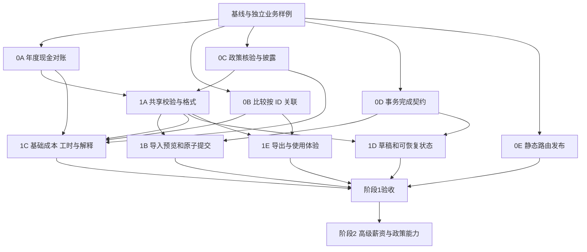

# Offerithm 技术实现分析与分阶段计划

> 本文为初始分析/方案快照；最新落地状态与验证边界见 [阶段0进展](04-phase0-progress.md)。

这是后续实现建议，不是本次已完成的应用改动。目标与验收编号见 [需求分析](01-requirements.md)，架构边界和接口见 [架构设计](02-architecture.md)。复杂度 S/M/L 表示相对工作量和验证范围，不是工期承诺。依据为四份 [调查证据](evidence/)，拟新增文件均明确标注。

## 1. 基线及限制

主会话已完成现有 16 项引擎测试、typecheck、lint、build，以及浏览器新建、录入薪资、保存、刷新持久化及删除 smoke。它们证明可构建及基础路径可运行，不证明税务口径、比较列身份、IO 原子性和政策有效性正确。唯一测试文件为 `src/core/engine/__tests__/engine.test.ts`；没有 UI、IndexedDB、JSON/CSV 自动化回归。测试组为税额 3、年度税额 3、保险 4、工资/阶梯 2、单 Offer 3、比较 1。

| 证据类别 | 当前事项 | 执行方式 |
| --- | --- | --- |
| 代码与数值推导已证实 | 非月度组件年度现金遗漏；比较得分错列 | 独立期望值回归，再最小修复；不等待高级 UI |
| 本地运行已验证 | Vite 生产预览 `/Offerithm/` main 为空，导航跳 `/offers` | 保留复现记录，修路由并验收实际发布环境 |
| 静态风险/待权威验证 | request success 早于事务完成、JSON 浅校验、年奖速算扣除口径、2025 示例政策 | IO设计先完善；税务加入权威 fixture，不把静态疑点当最终税额结论 |

下面的新测试和实现尚未执行。后续不依赖口径争议的 IO、ID 关联和路由修正可分别推进，不必等待高级功能。

## 2. 阶段与依赖

### 图 I：建议任务依赖

箭头为前置依赖，不表示必须单线程执行。政策核验只阻断涉及其口径的金额与发布声明，不阻断通用校验/事务基础工作。

## 3. 阶段 0：可信结果、真实提交和可用发布（P0）

| 任务 | 文件与具体动作 | 依赖/复杂度/主要风险 | 完成证据 |
| --- | --- | --- | --- |
| 0-BASE 固定基线 | 保存现有计算输入、v1JSON fixture和运行记录。拟新增fixture目录 `src/core/engine/__tests__/fixtures/`、`src/storage/__tests__/fixtures/` | 无；S；不混入私人Offer | 当前通过项与未覆盖项分列；数据来源可追溯 |
| 0A 完整现金组成 | `src/core/engine/index.ts`、`salary.ts`：使用完整年化聚合，明确年奖是否已包含，外层一次性只加一次；核对税基、企业成本、储蓄和预测下游 | 0-BASE；M；年奖重复计入、旧结果改变 | 月薪10000+季度3000样例税前132000；默认测试假设税4680、税后127320。再覆盖月/季/年/组件oneTime、免税和外层oneTime组合；AC-02 |
| 0B 比较身份关联 | `src/pages/ComparePage.tsx`、`src/core/engine/compare.ts`：按offerId建索引，统一所有列；逐步用entries替代平行数组 | 0-BASE；S/M；只修一行而漏其他调用 | 固定a/b、netCash单权重时A=0、B=100对应列；反序、并列和CSV一致；AC-04 |
| 0C 政策来源与fixture | `src/core/engine/tax.ts`、`src/policies/tax.ts`、`regions.ts`：核对年度、奖金税表与来源，先建立权威fixture，再改确认有误的规则；结果披露年份/示例状态 | 0-BASE；M/L；政策及舍入口径未定 | 年奖48000当前代码结果2280只作待核对记录，不能作正确期望。有效期、来源、独立复核值齐全；缺政策处理定案；AC-03 |
| 0D 事务完成语义 | `src/storage/db.ts`：request成功暂存，transaction complete才resolve；统一abort/error/同步异常、释放连接，处理blocked/versionchange | 0-BASE；M；Promise悬挂、重复settle、标签互锁 | request success后abort不报告成功；失败可重试；真实浏览器事务测试；AC-06 |
| 0E 路由发布 | `src/main.tsx`、`App.tsx`、`vite.config.ts`和workflow：选择basename+服务端回退或HashRouter，统一根/子路径导航 | 0-BASE；S/M；仅修资源base无法解决路由/刷新 | 根部署与`/Offerithm/`子部署：首页、导航、子页直达及刷新；实际Pages验收；AC-09 |

阶段 0 退出：0A/0B 有独立回归值且基线通过；0D 有真实提交与失败验证；0E 本地和真实发布地址均验收。0C 未完成时不得宣称税务结果已核验，其他独立修正仍可合并。不要在修现金表达式时盲目换成 `grossAnnual` 而重复计入已经聚合的奖金。

## 4. 阶段 1：完整的用户核心流程（P1）

| 任务 | 文件与具体动作 | 依赖/复杂度/主要风险 | 完成证据 |
| --- | --- | --- | --- |
| 1A 共享校验与格式契约 | 拟新增 `src/core/validation.ts` 或同职责目录；演进 `src/storage/io.ts`。unknown输入、嵌套字段、有限数/范围、ID/日期/枚举、阶梯和重复ID校验；识别旧版/未来版本；复用到表单和草稿 | 0A/0C对应口径；M；误拒历史合法数据 | 合法v1 fixture可读，未来版拒绝，错误有字段路径；不悄悄补未知值；AC-01、AC-07 |
| 1B 备份与原子导入 | `db.ts`增批量事务；`io.ts`解析/迁移保持纯函数；拟新增 `src/application/importWorkspace.ts`；`SettingsPage.tsx`预览新增/覆盖/冲突，提供当前数据备份，再确认提交 | 0D、1A；L；并发变化、部分覆盖 | 无效文件零写入；任一失败整批回滚；提交复核基线；实际新增/覆盖计数；AC-07 |
| 1C 基础输入和解释 | `OffersPage.tsx`、`ComparePage.tsx`；必要时拟拆 `src/components/offers/`、`comparison/`。先补生活成本、每周工时、通勤；展示默认/缺失、政策/假设、资产/现金区别和评分说明 | 0A、0B、1A、对应业务口径；M/L；静默默认误导 | 改成本/工时后结果可手算，重开保持；零支出不冒充实际预算；AC-01至AC-04 |
| 1D 草稿与可恢复状态 | `OffersPage.tsx`、`db.ts`；拟新增 `src/hooks/useOffers.ts`、`useOfferEditor.ts`。列出/恢复/删草稿，定义正式保存后清理；分开加载、保存、删除、刷新错误，保留内容 | 0D、1A；M；草稿误覆盖、已提交误报保存失败 | 草稿不参与正式比较；恢复不立即覆盖正式记录；事务完成再成功；AC-05、AC-06 |
| 1E 导出与使用体验 | `io.ts`、`SettingsPage.tsx`、`ComparePage.tsx`及必要样式：导出重读已提交数据、说明范围；CSV含情景/单位并标为报告，评估公式前缀处理；修订能力文案和状态语义 | 0B、格式与结果口径；M；CSV文本/列兼容性 | JSON往返等价；CSV引号/换行/中文/BOM和情景一致；键盘与窄屏人工验收；AC-08、AC-10 |

基础生活成本、工时/通勤是P1，因为默认零支出和固定工时已参与储蓄、时薪和排名。高级组件、阶梯与政策编辑器可延后，但导入这些字段的数据仍须正确计算和校验。

阶段 1 退出：新增两份Offer→填写基础成本/工时→比较→刷新→修改→JSON备份/恢复→删除有可重复浏览器回归；对应AC-01至AC-10有证据。文档准确列出未开放字段与未备份内容。

## 5. 阶段 2：确认需求后扩展（P2）

| 任务 | 建议范围 | 前置决策与复杂度 |
| --- | --- | --- |
| 2A 高级薪资/假设编辑 | 组件频率、固定/比例、计税/计基数、阶梯、一次性、三情景参数及专项扣除 | 阶梯基数语义、奖金优惠资格、单位和范围；L；复用校验与引擎 |
| 2B 政策管理与可复现性 | 显式CalculationContext、政策版本/来源；决定代码维护目录或用户编辑器，必要时升级快照 | 来源审核责任、历史重算、嵌入快照或版本引用；L；不因类型存在就建管理后台 |
| 2C 预测与评分语义 | 一次性不复发、年度值与累计财富区分、公积金归属、通勤/年假/出差、成长稳定代理指标 | 业务口径与独立样例；M/L；固定置信度不包装成概率 |
| 2D 其他数据能力 | 命名工作区、CSV导入、比较设置持久化 | 当前需求未完整定义，不纳入阶段1；不引入账户/同步 |

## 6. 技术约束与数据迁移

- 核心继续为纯函数。金额计算与格式化分开，展示舍入值不回流评分；先确认金额精度/舍入边界，再决定整数分或decimal。不强制新增数值库。
- 比较按ID连接并验证唯一/完整映射。零权重、单候选、并列与候选集变化需明确行为；数学归一化不能证明代理指标合理。
- 同一事务内完成冲突复核与写入，避免跨await让事务失活。导入先设文件规模限制并实测，不直接引入后端/队列。
- IndexedDB版本、快照schema版本、政策版本分别演进。没有schema变化不为重构升级数据库；保留v1 fixture，识别→验证旧结构→纯迁移→验证新结构→预览→原子提交，未知未来版拒绝。
- 数据库升级在升级事务内按oldVersion逐步执行，处理旧标签阻塞和失败回滚。回滚应用不一定能读取更新后的数据；需演练兼容或只读恢复，不以删库解决。
- UI使用组合组件与局部hooks，不要求全局状态库/状态机依赖。NavLink已有默认aria-current，得分已有可见数字；改进基于真实语义/状态/ID关联验证，不夸大既有缺失。
- Vite资源base、客户端basename和服务端回退分别验证。origin变化影响IndexedDB来源；域名迁移前提供可验证的文件导出恢复路径。

## 7. 测试策略

| 层次 | 新增验证重点 | 判定原则 |
| --- | --- | --- |
| 引擎单元 | 四频率、奖金重复、税阶前/处/后、缴费上下限、扣除、缺政策、一次性、工时和评分退化 | 期望来自独立手算/权威fixture，核对现金/税基/缴费/资产不变量，不能复制实现生成期望 |
| 校验与IO单元 | 非对象/缺嵌套/错误枚举/越界数/重复ID/未知版本、迁移、JSON往返、CSV特殊字符和公式前缀策略 | 字段路径诊断；领域意义等价；CSV不冒充完整备份 |
| IndexedDB集成 | complete/abort区别、原子批次、跨store草稿清理、blocked/versionchange、升级失败、并发冲突 | 模拟可辅助快速覆盖，事务时机仍须真实浏览器确认；quota按环境记录实测或模拟边界 |
| UI集成 | 身份反序比较、基础输入联动、草稿、读写/刷新失败、导入预览、重复选文件、状态播报 | 断言用户可见结果与ID，不以内部state细节为验收 |
| 浏览器E2E | CRUD持久化、比较情景/权重、JSON恢复/失败回滚、CSV下载、实际子路径导航刷新 | 独立测试数据；记录浏览器/环境，保留失败截图和console证据 |
| 人工验收 | 政策来源、读屏/键盘、320/375px窄屏、表格软件CSV、实际Pages | 人工与自动化结论分列，扫描不能证明完整可访问性 |

对行为改动运行相关单元/集成测试，并保持 `npm test`、typecheck、lint、build 基线。新增失败或新行为才扩大/重复测试；轻微文档改动不制造镜像测试。现有 `.github/workflows/ci.yml` 已配置 typecheck、lint、test、build；Pages workflow 只运行 test 和 build。工作流配置存在不等于远端最近一次运行已通过，本次未检查远端 CI 运行记录。

## 8. 风险与发布审阅

| 风险 | 缓解与发布条件 |
| --- | --- |
| 政策/税务口径不明 | 来源、年度、复核fixture齐全；未核实明确标示 |
| 现金修正改变历史结果 | 前后fixture与变更说明，验证年奖/一次性仅计一次 |
| 导入覆盖或部分失败 | 预览、备份、原子事务、失败零变更、并发复核和容量限制 |
| 本地数据清除/origin迁移 | 明确备份范围，实际导出恢复，不承诺浏览器存储永不丢失 |
| 升级后不能回滚 | 版本分离、历史fixture/原文件、升级和兼容演练 |
| UI范围扩张 | 先基础成本/工时，再高级字段；渐进提取组件而非重写 |
| 无依据的性能优化 | 建立1/10/100份Offer基线（建议规模，非测量结论），有瓶颈证据再考虑Worker或虚拟化 |
| 发布路径不一致 | 实际Pages子路径首页/子页/刷新验收，核对根路径导航和资源 |

每阶段审阅确认：事实与建议分开、README同步、核心不引入IO、迁移/覆盖规则已决定、新入口有验收、当前与目标图不混用。达到对应门槛后，才能把“建议”更新为“已交付”。
