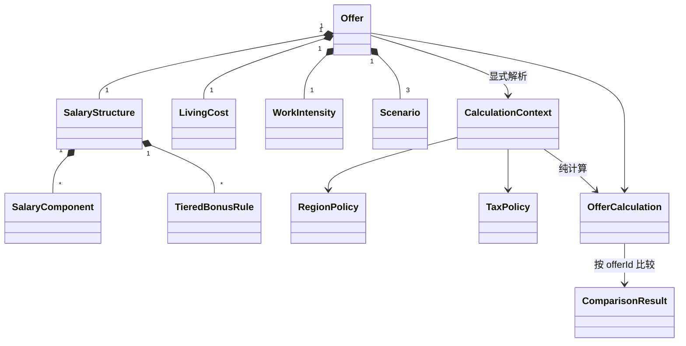

# 核心模型、计算链与架构草案

本文区分仓库现状与建议；建议不是既有需求。路径相对于仓库根目录，行号对应当前代码。未发现 `/workspace/Offerithm` 或 `/workspace` 内适用的 AGENTS.md。

## 现状证据与调用链

- 领域契约集中在 `src/core/types.ts:8`：`Uncertain<T>` 为值、置信度和说明；`SalaryComponent` 支持四种频率、固定金额或月基数百分比、计税和缴费标记（`src/core/types.ts:17`）；`SalaryStructure` 含基本工资、年奖方式、组件与阶梯规则（`:40`）。`RegionPolicy` 按年承载社保、公积金上下限及费率（`:62`），`TaxPolicy` 承载年度税表（`:92`）；`Offer` 包含三情景、生活成本、工作强度和一次性款项（`:131`）；结果和六维比较权重分别在 `:159`、`:191`。
- `calculateOffer(offer: Offer, options: CalcOptions = {}): OfferCalcResult`（`src/core/engine/index.ts:19`）依次解析地区/税务政策和情景 → `aggregateSalary`、`monthlyInsuranceBase` → `calculateInsurance` → `calculateAnnualTax` → 现金、生活成本、时薪和预测。默认静态地区表与 2025 税表；可传入政策和专项附加扣除，但现有页面调用时未传政策或扣除（`src/pages/OffersPage.tsx:69`、`src/pages/ComparePage.tsx:25`）。缺地区时按零缴费并警告（`src/core/engine/index.ts:25`）。
- `aggregateSalary(salary: SalaryStructure): SalaryAggregates`（`src/core/engine/salary.ts:39`）按频率年化、累计应税组件及阶梯年奖；`monthlyInsuranceBase(salary): number`（`:4`）仅使用月基本工资与标记计基数的月度组件。`tieredBonus(rule, monthlyBase): number`（`:12`）按档位逐段计算；其 `monthlyBase` 分支乘 12、`annualBase` 分支不乘，与输入名称及类型注释的语义需核实。
- `calculateInsurance(policy: RegionPolicy, monthlyInsuranceBase: number): InsuranceResult`（`src/core/engine/insurance.ts:20`）分别夹取社保和公积金基数，算个人/企业缴费、明细、住房公积金和医保账户。医保账户只近似个人缴费（`:51`）；明细的 `personalAccount` 则将个人和企业份额相加（`:26`），二者口径可能不一致。企业年金计入缴费但不独立输出账户价值（`:88`）。
- `calculateAnnualTax(input: AnnualTaxInput, policy: TaxPolicy): AnnualTaxResult`（`src/core/engine/tax.ts:43`）按年度基本减除、专项扣除、社保扣除计算综合所得；单独计税采用年奖除 12 确定档位（`:30`），不模拟预扣。当前单独计税直接使用年度速算扣除数（`:36`、`src/policies/tax.ts:11`），而月度年奖税表的速算扣除数口径不同，涉及较高档位时结果可能错误，须以适用年度官方规则和边界样例验证。
- `compareOffers(offers, results, weights): ComparisonResult[]`（`src/core/engine/compare.ts:17`）对当前候选集做 min-max 归一化，均等时全部 100（`:5`），按权重归一、排序；工作负荷以工时加全额通勤，成长以情景调薪差、稳定以企业成本、福利以公积金加医保代理（`:24`）。这是相对分数而非绝对价值或优化求解；没有搜索最优方案算法。候选集变化会改变分数；全零权重得零分（`:51`）；调用方必须保证 offers/results 同序且一一对应。比较页列头按原 offers 顺序，得分列按排序后 ranked 顺序（`src/pages/ComparePage.tsx:78`, `:101`），排名改变时得分可能落在错误公司列下。
- 政策预设只有北京、上海 2025 示例（`src/policies/regions.ts:9`），来源文字明确要求核对；税表为 2025 静态配置（`src/policies/tax.ts:8`）。`findPolicy(id): RegionPolicy | undefined` 只查内置数组（`src/policies/regions.ts:64`），并无地区政策持久化或编辑器，尽管文件注释提及设置页自行配置。

## 能力边界与风险

| 状态 | 证据与限制 |
| --- | --- |
| UI 已实现 | 录入名称、公司、地区、基本工资、年奖及税法选择；基准年度汇总、保存/草稿（`src/pages/OffersPage.tsx:56`, `:81`, `:115`）。比较页提供情景切换、权重、结果表和 CSV（`src/pages/ComparePage.tsx:25`, `:49`）。设置页只读显示政策、导入导出 Offer JSON（`src/pages/SettingsPage.tsx:16`, `:52`）。 |
| 引擎或模型已有，UI 未提供编辑 | 薪资组件、阶梯规则、一次性款项、生活成本、工作强度、情景参数、专项附加扣除、可注入政策（`src/core/types.ts:17`, `:105`, `:118`, `:139`; `src/core/engine/index.ts:9`）。导入数据可携带这些字段，但不等于具备编辑体验。草稿可写入但页面未列出或恢复（`src/storage/db.ts:52`; `src/pages/OffersPage.tsx:48`）。 |
| 缺失 | 自定义政策管理及生效版本选择、结构化运行时校验、逐月预扣、奖金税法自动择优、实质性不确定性传播、可复现的参数来源与计算审计。`fromJson` 仅检查 app 和 offers 数组（`src/storage/io.ts:19`），不是完整校验。 |
| 待确认 | 税务及地方缴费政策有效期、开户计入、缴费基数、不同奖金类型税务、预测和评分语义；不能把示例政策视为已核实事实。 |

关键计算风险：`aggregateSalary` 计算了完整 `grossAnnual`（`src/core/engine/salary.ts:72`），但 `calculateOffer` 使用 `grossMonthly * 12 + bonus + oneTimeTotal`（`src/core/engine/index.ts:55`），遗漏季度、年度及组件 oneTime 现金，却仍将其中应税部分计税；企业成本和预测随之偏低。预测将所有首年现金（包括一次性款）复利（`:73`），固定置信度不是统计估计。`annualSavings` 加入全部公积金（`:66`），其可提取性及现金等价语义需明确。时薪假定 50 周、每周五天、通勤折半（`:68`），未使用出差和年假；比较的工作负荷通勤不折半。数值缺少有限数、非负、比例、阶梯顺序、上下限及权重校验；缺政策以零代替未知与领域注释的诚实原则有张力（`src/core/types.ts:3`）。

## 建议架构（待业务确认）

保持函数式核心与命令式外壳：UI/导入 → 解析与版本迁移 → 运行时验证 → 显式选择政策快照和假设 → 纯函数计算 → 带来源/警告的结果 → UI/导出；IndexedDB、时间、UUID、文件访问只在外壳。核心不自行读注册表或系统时钟；保留既有引擎作为迁移适配层。计算与显示分离，精度和舍入规则集中管理，按 Offer ID 关联比较结果。缺少关键输入返回可诊断的不可计算状态，估计值携带假设，避免把未知当零。

建议接口示意（非现有 API）：

```ts
type Outcome<T> = { ok: true; value: T; warnings: Diagnostic[] } | { ok: false; errors: Diagnostic[] };
validateOffer(raw: unknown): Outcome<Offer>
resolveContext(offer: Offer, policies: PolicyCatalog, year: number): Outcome<CalculationContext>
calculateOfferPure(offer: Offer, context: CalculationContext, scenario: ScenarioKey): Outcome<OfferCalculation>
compareById(inputs: Array<{ offer: Offer; result: OfferCalculation }>, weights: ComparisonWeights): Outcome<ComparisonResult[]>
```

`CalculationContext` 应包含明确年度、地区及税务政策版本、扣除项、计税与舍入假设；`OfferCalculation` 区分现金流、缴费、税务、账户资产、生活成本、预测，每项带单位、来源及诊断；持久化快照保存 schema 版本和引用政策版本，提供迁移与导入校验。先用官方核实的样例覆盖税档边界、缴费上下限、年奖方式、组件频率、一次性收入、缺政策及候选顺序，再改动计算行为。



## 需确认的业务决策

1. 首年是否完整工作、入职月份、年终奖发放时点与一次性支付是否参与未来预测；哪些薪资项目计入缴费基数及单独计税资格。
2. 地区政策版本、官方来源、上下限调整时点，社保/公积金及年金的个人账户归属、专项扣除资格、舍入方式；政策缺失时是否阻断计算。
3. 是否提供并入/单独计税对比与自动选择，以及专项附加扣除、历史收入、预扣/汇算的边界；需要按政策年度验证。
4. 储蓄是否包含不可立即支取的账户资产；有效工时怎样处理假期、出差、工作日和通勤；增长、稳定和福利是否改为用户评价而非代理，及权重全零或候选并列的处理。
5. 情景倍数、调薪、置信度的来源与展示方式；数据迁移、政策快照与导入冲突的用户可见规则。

### 已证实的年度现金遗漏：数值复现（P0 候选）

构造 `baseMonthly = 10000`、`annualBonus = 0`，唯一组件为 `frequency = 'quarterly'`、`amountType = 'fixed'`、`amount = 3000`、`taxable = true`；无一次性款项、专项扣除为零，使用不存在的地区政策（社保为零并产生警告）、默认 2025 税表。`aggregateSalary` 得到 `grossMonthly = 10000`、`grossAnnual = 132000`、`taxableAnnualExcludingBonus = 132000`（`src/core/engine/salary.ts:44`, `:63`, `:72`）。但 `calculateOffer` 返回的税前现金为 `10000 × 12 = 120000`（`src/core/engine/index.ts:43`, `:55`），少 12000；税务却按 132000 减基本减除 60000 计税，即 4680 元（`src/core/engine/tax.ts:43`; `src/policies/tax.ts:10`），税后现金因而为 115320，而在其他假设不变且季度组件确实是现金的口径下应为 127320。年度与组件级 oneTime 项同样被该表达式遗漏。此为现有实现和类型注释之间可直接证明的不一致；是否将特定组件纳入年奖优惠、预测或缴费基数仍是独立业务规则，不能由此例决定。

## 汇总类图的现有类型摘录

以下为实际 TypeScript 契约的关键字段，非建议模型；`Scenario` 不是现有独立类型，实际是 `Offer.scenarios` 的内联对象（`src/core/types.ts:131`）：

```ts
type ScenarioKey = 'pessimistic' | 'base' | 'optimistic';
interface Uncertain<T> { value: T; confidence: number; note?: string }
interface Offer {
  id: string; name: string; companyName: string; regionPolicyId: string;
  salary: SalaryStructure;
  scenarios: Record<ScenarioKey, { raiseRate: number; bonusMultiplier: number }>;
  livingCost: LivingCost; work: WorkIntensity;
  oneTimePayments: Array<{ name: string; amount: number; taxable: boolean }>;
  notes?: string; createdAt: string; updatedAt: string;
}
interface OfferCalcResult {
  offerId: string; grossAnnualCash: number; employeeInsuranceAnnual: number;
  employerInsuranceAnnual: number; incomeTaxAnnual: number; netAnnualCash: number;
  netMonthlyCash: number; housingFundAnnual: number; medicalAccountAnnual: number;
  employerTotalCostAnnual: number; livingCostAnnual: number; annualSavings: number;
  insuranceBreakdown: InsuranceBreakdownItem[]; effectiveHourlyRate: number;
  projection: Record<'year1' | 'year3' | 'year10', Uncertain<number>>;
  warnings: string[];
}
interface ComparisonResult {
  offerId: string; name: string; totalScore: number;
  criterionScores: Record<Criterion, number>;
}
interface CalcOptions {
  policy?: RegionPolicy; taxPolicy?: TaxPolicy;
  specialAdditionalDeductions?: number;
  scenario?: 'pessimistic' | 'base' | 'optimistic';
}
```

契约来源分别为 `src/core/types.ts:8`, `:133`, `:159`, `:201` 和 `src/core/engine/index.ts:9`。`Criterion` 是 `netCash | savings | workLifeBalance | growth | stability | benefits`（`src/core/types.ts:191`）。

年奖静态疑点算例：年奖 48,000 元时，代码以 4,000 元/月选中第二档（年度上限 144,000 除以 12；税率 10%，年度速算扣除数 2,520），返回 `48,000 × 10% - 2,520 = 2,280` 元（`src/core/engine/tax.ts:31`; `src/policies/tax.ts:13`）。这里可直接确认代码使用年度速算扣除数；合法税额及月度表与政策有效期仍需查证官方适用规则，不能仅凭静态算例断言最终金额。
